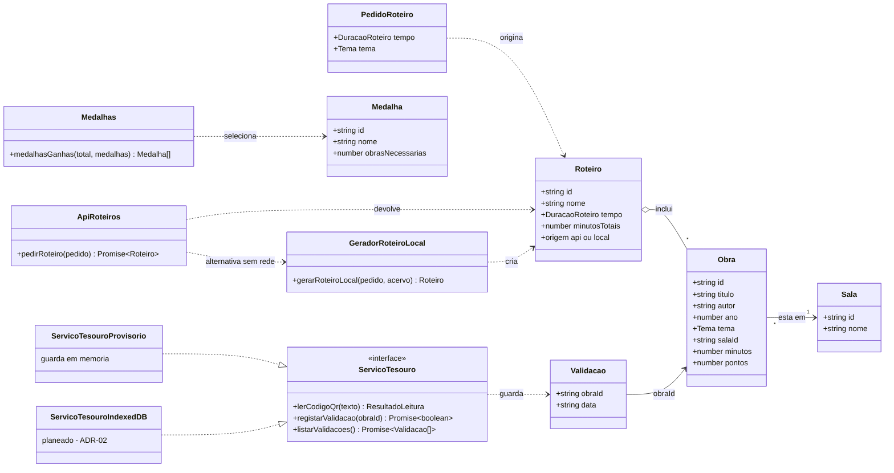
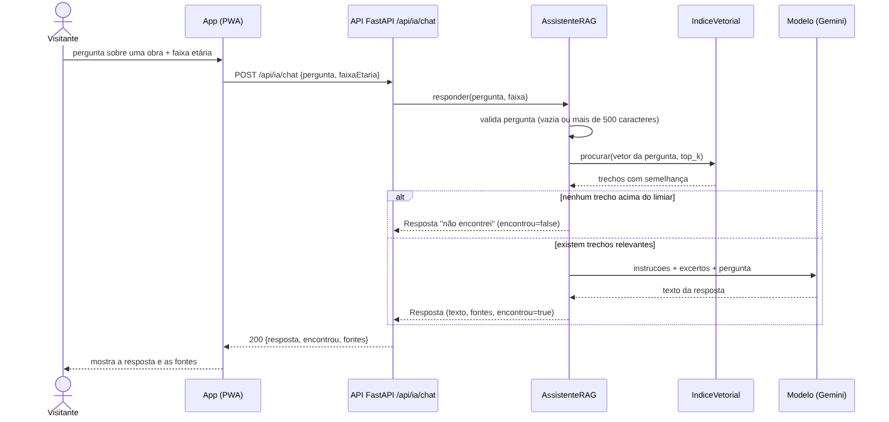

# App MNSR Digital

Guia digital para o **Museu Nacional Soares dos Reis** (Porto), desenvolvido pela nossa equipa na unidade curricular de Engenharia de Software (ESOF), Universidade Fernando Pessoa.

> **Estado atual:** fase de definição concluída (marcos M0, M1 e M2). A implementação dos módulos arranca no Sprint 2. Ver [Estado do projeto](#5-estado-do-projeto).

## Índice
1. [Contexto e problema](#1-contexto-e-problema)
2. [Objetivos e KPIs](#2-objetivos-e-kpis)
3. [A solução: 4 módulos](#3-a-solução-4-módulos)
4. [Arquitetura e modelação](#4-arquitetura-e-modelação)
5. [Estado do projeto](#5-estado-do-projeto)
6. [Gestão do projeto](#6-gestão-do-projeto)
7. [Governação de IA](#7-governação-de-ia)
8. [Stack tecnológica](#8-stack-tecnológica)
9. [Estrutura do repositório](#9-estrutura-do-repositório)
10. [Equipa](#10-equipa)

## 1. Contexto e problema
O MNSR, no Palácio dos Carrancas, retém apenas **7,1%** do fluxo turístico de referência do Porto (cerca de 85.000 visitantes por ano). O público é envelhecido (62% são seniores em excursões), as visitas são curtas (42 minutos em média) e há sobrelotação das salas entre as 11h e as 15h. A App MNSR Digital transforma a visita numa experiência interativa e gamificada, que funciona mesmo sem rede dentro do palácio.

## 2. Objetivos e KPIs

| Indicador | Hoje | Meta |
| --- | --- | --- |
| Jovens e famílias (menos de 25 anos) | 27% | mínimo de 45% |
| Tempo médio de visita | 42 min | 65 min |
| Retorno anual de residentes do Porto | menos de 5% | 18% |
| Visitantes entre as 11h e as 15h | 70% | máximo de 45% |

## 3. A solução: 4 módulos

| Módulo | O que faz |
| --- | --- |
| **A. Roteiros dinâmicos** | O visitante escolhe o tempo (30, 60 ou 90 min) e o tema, e recebe um roteiro com as obras por sala. Funciona offline. |
| **B. Caça ao tesouro** | QR Codes junto às obras dão pontos e medalhas (1, 3 e 5 obras), por faixa etária. |
| **C. Assistente de IA** | Responde a perguntas sobre as obras usando só os textos oficiais do museu (RAG). |
| **D. Afluência** | Mostra a ocupação das salas e sugere alternativas menos cheias. |

## 4. Arquitetura e modelação

Três componentes, cada um com a decisão registada num ADR:

| Componente | Tecnologia | Decisão |
| --- | --- | --- |
| PWA offline | React, TypeScript, service worker, IndexedDB | [ADR-02](docs/adr/adr_02_bd_local_indexeddb.md) |
| API principal | Spring Boot, arquitetura limpa em 3 camadas, REST | [ADR-01](docs/adr/adr_01_arquitetura_em_camadas_rest.md) |
| Serviço de IA | Python, FastAPI, RAG sobre os textos do museu | [ADR-03](docs/adr/adr_03_assistente_ia_rag.md) |

### Diagrama de classes (domínio)


### Diagrama de sequência (assistente de IA)
O assistente só chama o modelo se existirem excertos relevantes, e o modelo só pode usar esses excertos. Estas são as duas defesas contra alucinações.



Mais diagramas: [classes](docs/uml/diagrama_classes.md) e [sequência (roteiro, assistente e QR)](docs/uml/diagramas_sequencia_roteiros_ia.md).

## 5. Estado do projeto

| Marco | Conteúdo | Estado |
| --- | --- | --- |
| **M0** | Repositório, README e Carta de Uso Responsável de IA | ✅ Concluído |
| **M1** | Visão de produto, backlog com 10 User Stories, Definition of Done e Sprint Backlog | ✅ Concluído (falta ligar o Kanban) |
| **M2** | ADR-01, ADR-02 e ADR-03 aprovados, diagrama de classes e diagramas de sequência | ✅ Concluído |
| **M3** | Módulos A e B funcionais, com testes e cobertura | ⏳ Sprint 2 |
| **M4** | Integração contínua e logging em JSON | ⏳ Planeado |
| **M5** | Padrões Strategy e Observer, segurança (OWASP) e AI_LOG completo | ⏳ Planeado |
| **M6** | Release Candidate v1.0.0-RC e defesa final | ⏳ Planeado |

## 6. Gestão do projeto
* [Visão do produto](docs/vis_o_do_produto.md)
* [Backlog e User Stories](docs/backlog_e_user_stories.md): 10 histórias com os 3 Cs, 21 cenários BDD (Given / When / Then) e tabela de rastreabilidade com os requisitos
* [Sprint Backlog](docs/sprint_backlog.md): Sprint 1 concluído e Sprint 2 planeado, com tarefas e responsáveis
* [Definition of Done](docs/definition_of_done.md)

## 7. Governação de IA
A equipa adota a filosofia *scaffold first, automate second* e compromete-se a ser transparente no uso de IA generativa. Tudo o que a IA gera é lido, testado e corrigido por nós antes de entrar no repositório.
* 📄 [Carta de Uso Responsável de IA](docs/CARTA_IA.md)
* 🔎 [Registo de Proveniência de IA (AI_LOG)](docs/AI_LOG.md)

## 8. Stack tecnológica
* **Frontend:** TypeScript, React (Progressive Web App)
* **Backend:** Java, Spring Boot
* **Assistente de IA:** Python, FastAPI
* **Dados:** PostgreSQL (servidor) e IndexedDB (offline, no telemóvel)
* **Qualidade:** JUnit, JaCoCo, PyTest, GitHub Actions

## 9. Estrutura do repositório

```
├── backend/   API Spring Boot
├── frontend/  PWA em React e TypeScript
├── ia/        Serviço do assistente de IA (Python)
└── docs/      Documentação do projeto
    ├── adr/   Decisões de arquitetura (ADR-01, 02 e 03)
    └── uml/   Diagramas de classes e de sequência
```

> As instruções de instalação e execução ("Como correr") serão publicadas com o Incremento M3.

## 10. Equipa
**Equipa:** Guilherme Taipa, João Reis, José Martins e Ricardo Pereira.
