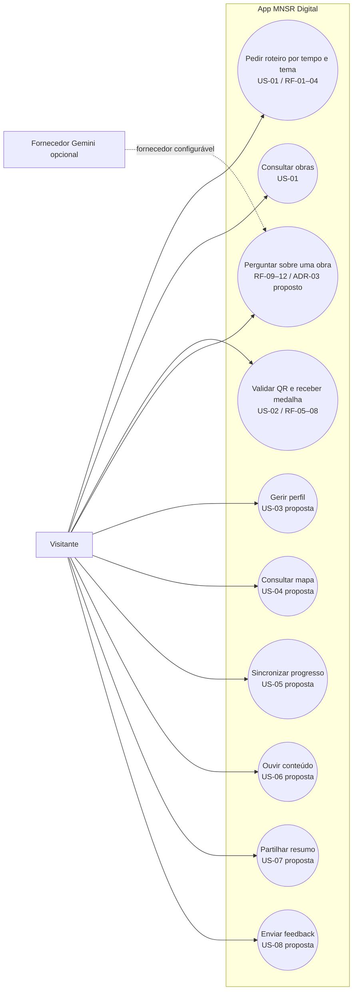

# Casos de uso — App MNSR Digital

O diagrama representa funcionalidades já identificadas em US-01/US-02 e no ADR-03. US-03–08 estão assinaladas como propostas a validar no backlog e não são apresentadas como implementadas.

Nota: o diagrama fonte usa Mermaid. Exportação PNG: `casos_de_uso.png`.
