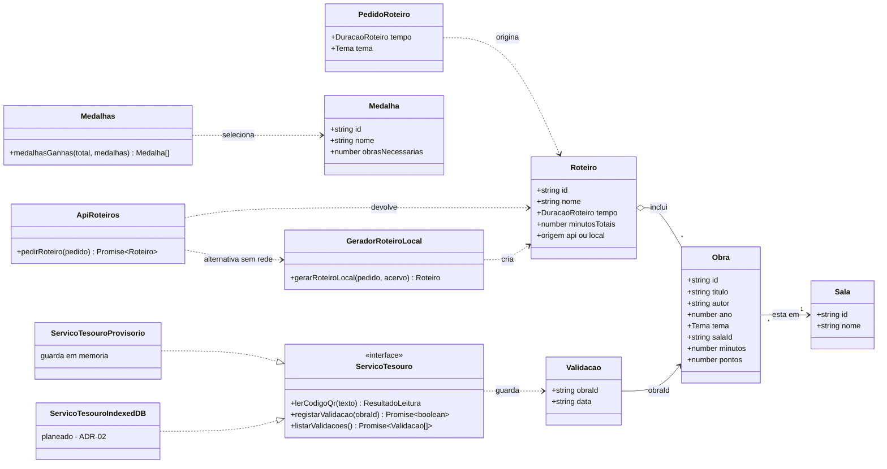
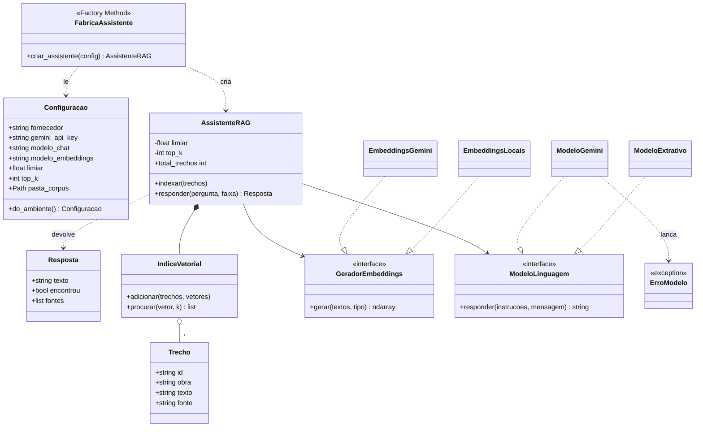

# Diagramas de Classes (Marco M2)

Os diagramas descrevem as classes que existem no código atual. Estão separados por componente para serem legíveis.
Substituem o diagrama anterior (`Diagrama uml.jpg`), que incluía `Visitante` e `DesafioGamificado`, classes que não existem no código (e `Visitante` com nome e localização contraria o RNF-03).

## 1. Domínio e serviços da PWA (`frontend/src/`)

Ficheiros: `types/dominio.ts`, `data/acervo.ts`, `services/` (`api.ts`, `roteiroLocal.ts`, `tesouro.ts`, `tesouroProvisorio.ts`, `medalhas.ts`).
O `ServicoTesouroIndexedDB` ainda não existe: está planeado no ADR-02 (tarefa T-01) e vai substituir o serviço provisório em memória.

## 2. Assistente de IA (`ia/app/`)

Ficheiros: `rag.py`, `vetorial.py`, `embeddings.py`, `llm.py`, `corpus.py`, `config.py`, `fabrica.py`.
Padrões: **Strategy** (`GeradorEmbeddings` e `ModeloLinguagem` com implementações trocáveis) e **Factory Method** (`criar_assistente`). Ver ADR-03.

