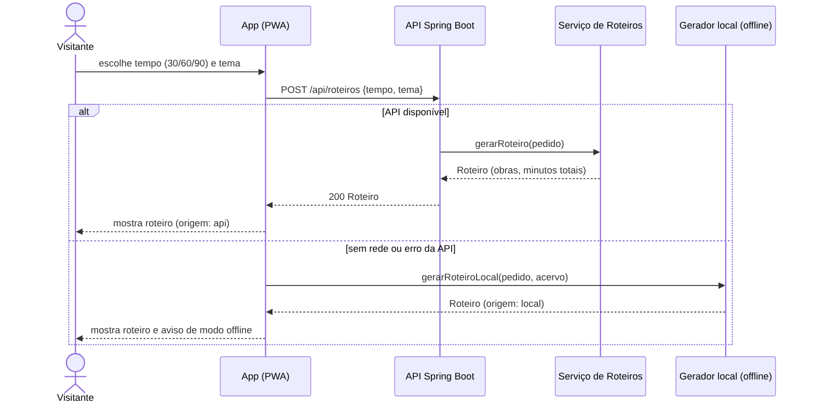
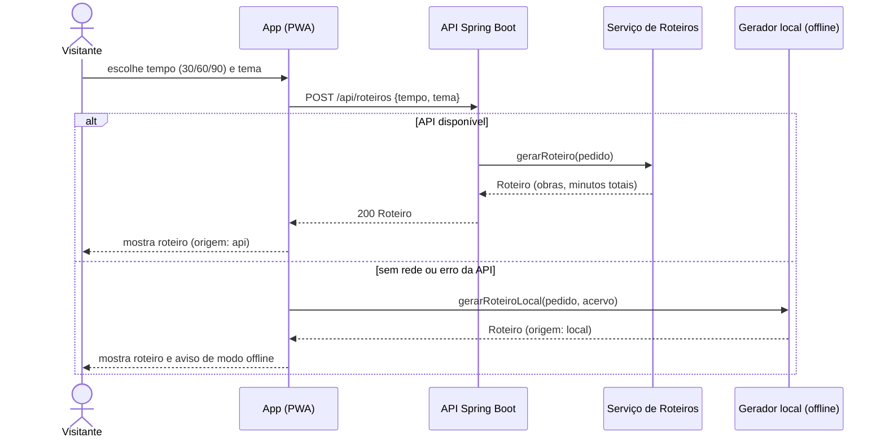
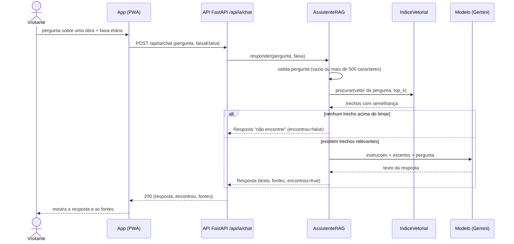
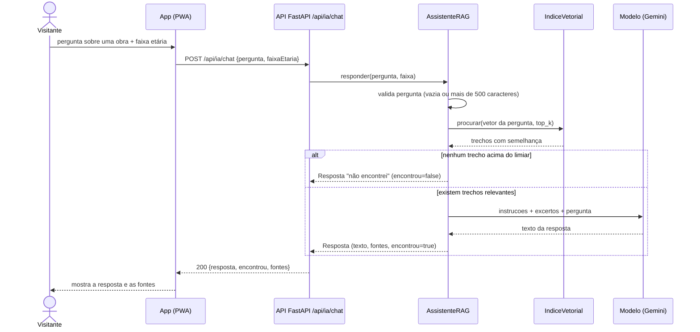
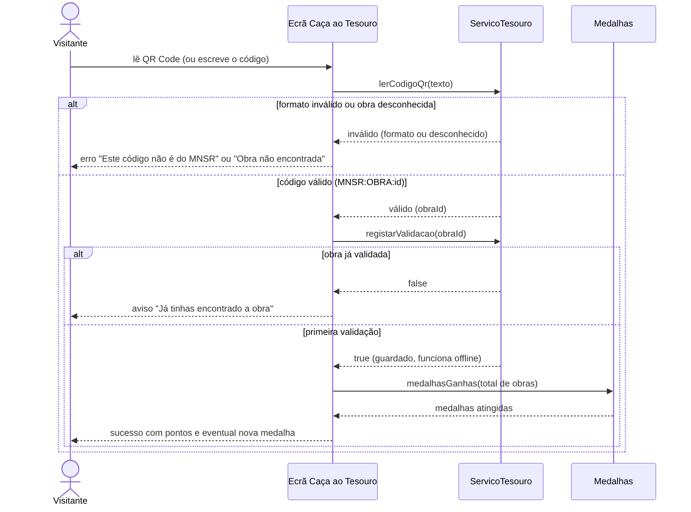
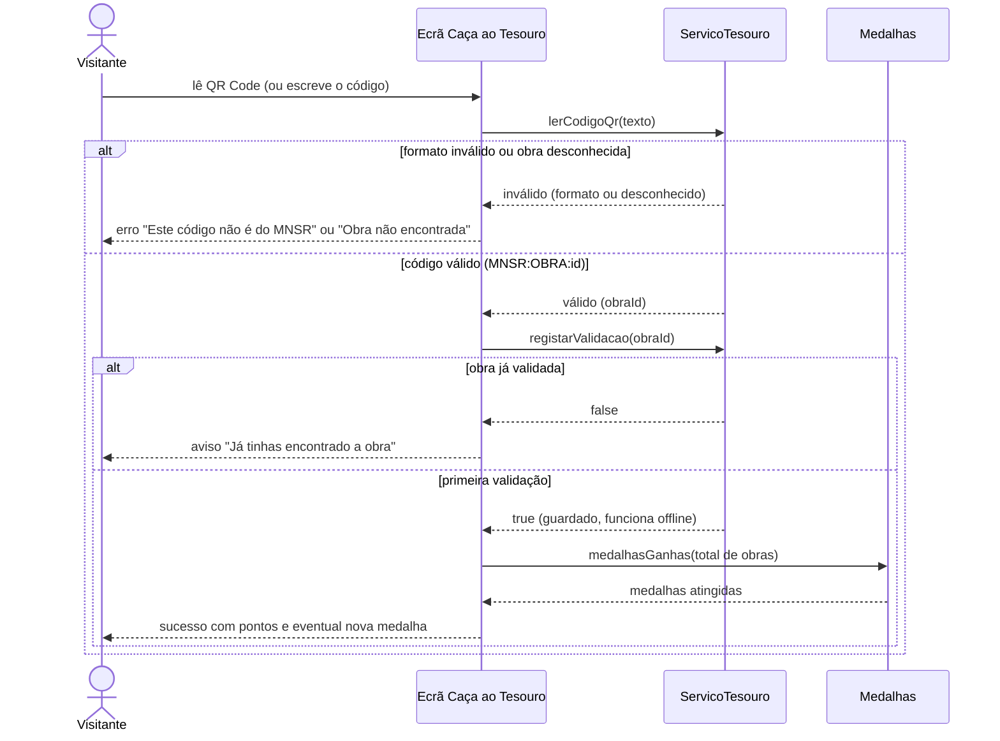

# Diagramas de Sequência: Roteiros, Assistente de IA e Caça ao Tesouro (Marco M2)

Estes diagramas descrevem o comportamento real do código atual:
`frontend/src/services/api.ts` e `roteiroLocal.ts` (Roteiros) e `ia/app/` (Assistente de IA).
Substituem os diagramas anteriores (`Diagrama de Sequencia.jpg` e o `Diagrama uml.jpg`), que mostravam uma arquitetura (API Gateway, base de dados, base vetorial, `ValidadorQR`) que não existe no código.

## 1. Gerar roteiro (US-01, RF-01 a RF-04)

O frontend pede o roteiro à API. Se a API não responder (sem rede ou erro), gera-o localmente no telemóvel (RNF-02).

## 2. Perguntar ao assistente de IA (US-04 e US-05, RF-09 a RF-12)

O assistente só responde com os excertos oficiais do museu. Sem excertos relevantes, não chega a chamar o modelo (defesa contra alucinações).

## 3. Validar um QR Code na caça ao tesouro (US-02 e US-03, RF-05 a RF-08)

A validação acontece no telemóvel (`ServicoTesouro`), por isso funciona sem rede (RNF-02).

## Notas

* `POST /api/roteiros` ainda não existe no backend Spring Boot: enquanto não for implementado, o ramo "sem rede ou erro da API" é o único que corre. Atualizar o diagrama quando o endpoint existir.
* O assistente de IA corre num serviço Python separado (ver `docs/adr/adr_03_assistente_ia_rag.md`).
